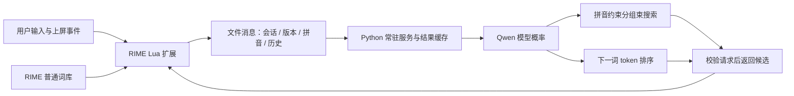

# Typing Agent · 上下文感知中文输入法

基于 **Qwen3-1.7B-Base、PyTorch、Transformers 和 RIME/Lua** 的实验性中文输入法。输入全拼时结合近期上屏历史生成拼音约束候选；文字上屏后，根据上下文提供下一词/短语预测。

项目包含约束解码实现、独立模型服务、RIME Lua 扩展、自动化测试和小规模实测报告。目前是研究与工程验证原型，不是成熟输入法发行版。

## 功能

| 功能 | 实现与边界 |
| --- | --- |
| 上下文候选 | 当前 RIME 会话最近 256 个已提交字符；模型侧另有 512 token 截断 |
| 全拼约束 | 无声调全拼、显式音节分隔、多音字匹配路径 |
| 分组束搜索 | 先过滤非法 token 再剪枝，组间惩罚鼓励多样性，最终按原始模型分数排序去重 |
| 下一词预测 | 一次前向计算，选择单个 token 表示的 2–6 字中文短语，最多返回 5 个 |
| 常驻服务 | 模型加载一次，通过本地文件消息与 RIME 通信 |
| 响应优化 | 预测预取、最多 64 项 LRU 结果缓存、防抖、普通词库兜底 |
| 过期结果处理 | 发布和展示前校验 session/revision、拼音及上下文 |

示例：先提交“我想吃”，再输入 `pingguo`，稍候按 **F6** 刷新，可看到带 `AI` 标记的候选“苹果”。开启续写后，提交文字会尝试显示带“预测”标记的候选。

**拼音 AI 候选目前需要 F6 刷新。** 下一词预测支持自动触发，但预取未完成时上屏阶段最多等待 400 ms，尚未实现全链路无阻塞。

## 工作方式



拼音约束在搜索的每一步检查 token 内汉字的合法读音路径，不匹配的扩展在剪枝前被排除；不是仅在提示词里要求模型遵守拼音。

## 环境与安装

- Python 3.11 或以上。
- 命令行推理提供 CPU（FP32）和 CUDA（FP16）路径，已有实测使用 V100 16GB。
- RIME 常驻服务和真实引擎测试面向 **Windows**，使用 Windows 进程锁及 librime DLL。
- 输入法接入需要小狼毫、librime-lua 和 `luna_pinyin_simp` 方案。

```powershell
git clone https://github.com/jokerpu123/Typing_agent.git
cd Typing_agent
python -m venv .venv
.\.venv\Scripts\python.exe -m pip install --upgrade pip
# 先按显卡与驱动条件安装合适的 PyTorch 构建，再安装项目。
.\.venv\Scripts\python.exe -m pip install -e ".[model,rime,test]"
```

已有 CUDA 环境应先确认 PyTorch 可以识别显卡，避免盲目替换已验证的构建。仓库不分发模型权重，安装 Python 包也不会自动下载模型。

### 准备模型

```powershell
.\.venv\Scripts\python.exe -m typing_agent.download_model --destination D:\models\Qwen3-1.7B-Base
```

下载器从官方模型仓库取得当次 revision 并固定该次下载，将版本及文件大小写入 `download_manifest.json`，并检查磁盘空间。它不保证始终下载历史基准所用版本。也可自行准备完整本地权重和 tokenizer。

推理使用 `local_files_only=True`，不自动联网下载。`download_weights` 是针对历史固定权重哈希的恢复下载工具，不应与任意新版本的配置混用。

### 命令行候选生成

```powershell
.\.venv\Scripts\python.exe -m typing_agent --model D:\models\Qwen3-1.7B-Base --context "我想吃" --pinyin pingguo
```

输出候选、累计 log probability 和解码耗时。可加 `--device cpu`，或用 `--beams 4 --groups 2` 调整搜索预算，束宽须能被组数整除。Base 模型直接续写原始上下文，不使用聊天模板，也没有进行项目专用微调。

## 接入 RIME

完整步骤见 [RIME 接入与排查](integration/rime/README.md)。以下 D 盘路径仅为示例，需要替换成自己的模型路径和小狼毫实际用户目录。

```powershell
.\.venv\Scripts\python.exe -m typing_agent.deploy_rime --user-dir D:\typing-agent\rime-user
# 在小狼毫菜单执行“重新部署”，然后启动模型服务：
.\.venv\Scripts\python.exe -m typing_agent.rime_service --model D:\models\Qwen3-1.7B-Base --mailbox D:\typing-agent\rime-user\typing-agent-ipc
```

看到 `RIME worker ready` 后，F4 选择“智能拼音 · Qwen”。服务不带参数时及 PowerShell 便捷脚本沿用开发机 D 盘路径；其他机器推荐使用上述显式参数命令。

| 操作 | 效果 |
| --- | --- |
| F6 | 刷新 AI 拼音候选；无拼音时重试下一词预测 |
| Ctrl+F6 | 清空当前会话的提交历史 |
| F4 → 续写开/关 | 切换下一词预测 |
| 空格 / 数字 | 选择候选并上屏 |
| Esc | 关闭预测候选 |
| 继续输入字母 | 退出预测状态，开始新的拼音输入 |

无上下文或模型服务停止时，普通词库仍能使用。服务目前没有开机自启。

## 测试

无需模型权重或 RIME 安装即可运行自动化测试：

```powershell
.\.venv\Scripts\python.exe -m pip install -e ".[test]"
.\.venv\Scripts\python.exe -m unittest discover -s tests -v
```

当前包含 18 个测试方法，覆盖约束剪枝、多样性、多字 token、多音字、音节边界、请求协议、过期结果、Lua 回调、历史清理及下载空间检查。缺少 `lupa` 或 `pypinyin` 时对应测试会跳过；自动化测试不替代真实输入法 UI 验收。

真实服务及引擎验证使用 `typing_agent.bridge_smoke` 和 `typing_agent.rime_engine_smoke`。后者保留开发机安装、用户和日志路径，需调整后运行，并按模块说明避免与小狼毫同时打开同一用户词库。

## 小规模性能记录

历史报告：[V100 基准](benchmarks/qwen3-1.7b-v100-baseline.json)。

| 配置 / 指标 | 记录 |
| --- | --- |
| 模型 | Qwen3-1.7B-Base |
| 硬件与精度 | Tesla V100-SXM2-16GB / FP16 |
| 搜索 | 4 beams / 2 groups |
| 样例 | 5 条人工编写的短上下文与全拼 |
| 第二轮暖态耗时中位数 | 397.3 ms |
| 第二轮最大耗时 | 768.8 ms |
| 该组样例首选命中 | 5 / 5 |
| PyTorch 峰值张量显存 | 约 3.45 GB，不含驱动等开销 |

暖态是同样的 5 条样例执行第一轮后再次执行，仍进行模型计算，不是服务端结果缓存命中。计时包含设置上下文与约束搜索，不含模型加载，也不代表按键到 UI 展示的端到端延迟。5 条样例不足以推断通用准确率、P95 或实际输入体验。

```powershell
.\.venv\Scripts\python.exe -m typing_agent.benchmark --model D:\models\Qwen3-1.7B-Base --output .cache\benchmark.json
```

其他历史报告：[服务消息往返](benchmarks/rime-service-smoke.json)、[引擎选词与上屏](benchmarks/rime-engine-smoke.json)、[自动预测及继续输入](benchmarks/rime-prediction-smoke.json)。这些报告不表示每次构建都重新执行 GPU 或 Windows UI 验证。

## 目录

```text
typing_agent/       约束搜索、模型后端、服务、协议与命令行工具
integration/rime/  RIME 方案、Lua 扩展和接入说明
tests/             自动化测试
benchmarks/        人工样例及历史实测报告
scripts/           开发机服务启动 / 重启脚本
pyproject.toml     Python 包配置及可选依赖
```

## 当前限制

- 仅支持完整无声调全拼，暂不支持简拼、模糊音和未完成音节。
- 多音字表不等于语境读音消歧，低排名候选可能出现生僻读音或异常切分。
- 仅使用能解码成完整中文字符的 token，排除拆分 UTF-8、混合标点等 token，并非全词表覆盖。
- 搜索逐路径完整前向、CPU 检查候选；尚未实现跨步 KV 复用、分支批处理或 GPU 拼音 mask。
- 下一词限于单个 token，可能产生“一个”等泛化短语，并非多 token 词语或完整句子搜索。
- 历史来自 RIME 会话提交事件，不读取应用文档。移动光标后不一定等于光标前真实文本，会话也不保证与应用窗口一一对应。
- 本地消息含拼音与提交历史；提交、取消及过期清理会删除消息，进程内缓存随服务退出释放。推理在本地进行，但本机文件访问者仍可能读取临时消息。

后续方向：更大规模对照评测、读音过滤、token–拼音索引、KV 缓存、批量搜索及非阻塞候选自动刷新。

## 相关项目

- [Qwen3-1.7B-Base](https://huggingface.co/Qwen/Qwen3-1.7B-Base)
- [Transformers](https://github.com/huggingface/transformers)
- [RIME](https://github.com/rime/librime) / [小狼毫](https://github.com/rime/weasel) / [librime-lua](https://github.com/hchunhui/librime-lua)

第三方模型、输入法及依赖遵循各自许可证。本仓库不包含权重、第三方参考源码副本、个人文档或运行缓存。
